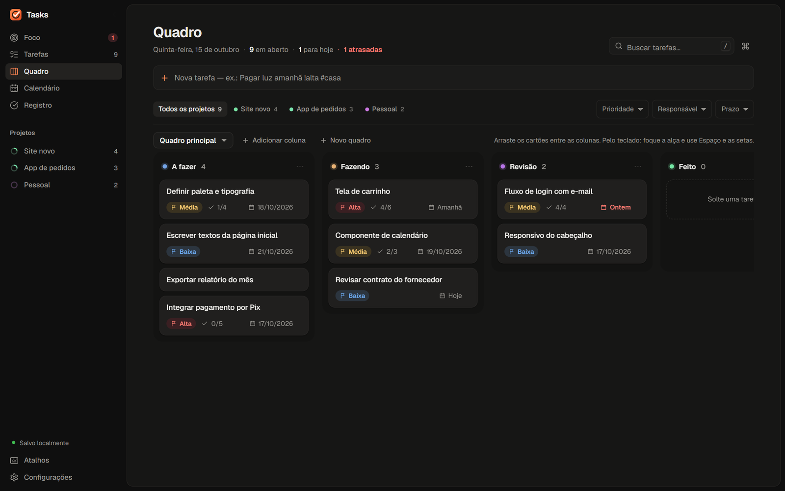

# Tasks

Organizador de tarefas para Windows que funciona sem internet. Sem conta, sem assinatura, sem nuvem: seus dados ficam no seu computador.

## Baixar

**[Baixar para Windows](https://github.com/FabioMarinhoDesenvolvedor/tasks/releases/latest/download/Tasks_x64-setup.exe)** · grátis · Windows 10 e 11 (64 bits) · cerca de 3 MB

Todas as versões e as notas de cada uma estão em [Releases](https://github.com/FabioMarinhoDesenvolvedor/tasks/releases).

## O que ele faz

- **Cinco lugares:** Foco (atrasadas, hoje, em andamento e próximos 7 dias, sem repetir tarefa), Tarefas, Quadro, Calendário e Registro do que foi concluído.
- **Escreva e pronto:** “Pagar luz amanhã !alta #casa” vira uma tarefa com prazo, prioridade e projeto.
- **Quadros com colunas de fluxo** que você mesmo define, com arrastar e soltar (pelo teclado também).
- **Projetos, responsáveis, checklists e etiquetas.**
- **Backup e restauração verificados**, e importação de quadros em JSON.
- **Cinco temas:** Grafite, Tokyo Night, Catppuccin Mocha, Gruvbox e Papel.
- Interface em português e atalhos de teclado para quase tudo.

## Instalar

1. Baixe `Tasks_x64-setup.exe` e abra.
2. O instalador ainda não tem assinatura digital, então o Windows pode mostrar o aviso **“O Windows protegeu o computador”**. Clique em **Mais informações → Executar assim mesmo**. Se quiser conferir o arquivo antes, o SHA-256 de cada versão está nas notas da release.
3. O Tasks é instalado só para o seu usuário (não pede senha de administrador) e cria atalhos no menu Iniciar e na área de trabalho.

O Tasks usa o **Microsoft Edge WebView2**, que já vem no Windows 11 e na maioria das instalações do Windows 10. Se faltar, baixe em [developer.microsoft.com/microsoft-edge/webview2](https://developer.microsoft.com/microsoft-edge/webview2/).

## Seus dados

- Ficam em `%LOCALAPPDATA%\com.tasks.desktop\tasks.sqlite3`, um único arquivo SQLite no seu computador. Nada é enviado para lugar nenhum.
- Atualizar para uma versão nova não apaga nada. Feche o Tasks antes de instalar a versão nova.
- Para guardar uma cópia, use **Configurações → Exportar backup**. A restauração mostra o que será trazido antes de substituir, e guarda uma cópia de segurança dos dados atuais.

## Segurança

- **Não usa internet.** O Tasks não envia, não sincroniza e não coleta nada; não tem telemetria nem atualização automática. A janela só carrega o próprio aplicativo.
- **Permissões mínimas.** A interface não acessa arquivos nem programas do computador por conta própria: ela só pode pedir as operações do Tasks (salvar tarefa, mover, exportar backup…), e cada pedido é validado antes de tocar no banco.
- **Arquivos de fora são tratados como não confiáveis.** Importações em JSON têm limite de tamanho e validação completa. Backups `.sqlite3` são abertos só para leitura, sem confiar no esquema que trazem, e recusados se contiverem algo que o Tasks não cria. Antes de substituir seus dados, uma cópia de segurança verificada é guardada.
- **Dependências auditadas.** Cada versão só é gerada se as bibliotecas passarem sem vulnerabilidades conhecidas (RustSec e npm).
- **Confira o arquivo.** O instalador ainda não tem assinatura digital; o SHA-256 de cada versão está nas notas da release.

Encontrou um problema de segurança? Abra uma [issue](https://github.com/FabioMarinhoDesenvolvedor/tasks/issues) sem detalhes sensíveis e eu entro em contato.

## Desinstalar

Em **Configurações do Windows → Aplicativos**, procure “Tasks” e desinstale. Se pretende reinstalar depois, mantenha os dados do aplicativo quando o desinstalador perguntar.

---

Feito por [Connections Hub](https://connections-hub-zeta.vercel.app). Rust, Tauri 2, React e SQLite.
